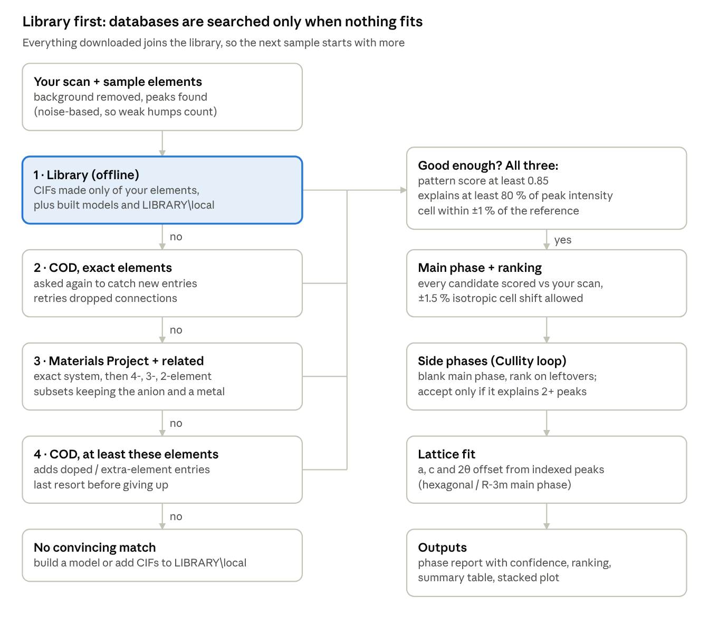

# XRD Reference Search & Phase ID

Automated phase identification for powder X-ray diffraction (XRD), built on [pymatgen](https://pymatgen.org).

Give it a powder XRD scan and the elements in your sample, and it returns the phases present, how confident each assignment is, and the lattice parameters of every identified phase. It finds its own reference structures: first in a local library of CIF files, then in the [Crystallography Open Database (COD)](https://www.crystallography.net/cod/) and [Materials Project](https://materialsproject.org) only when the library has no convincing match. Everything it downloads joins the library, so each new sample starts with more.



## Features

- **Library-first reference search** in four stages (local library → COD exact elements → Materials Project and related chemical systems → COD superset), stopping at the first stage whose best match passes three tests: pattern score, share of peak intensity explained, and cell shift.
- **Mixtures**: name the chemical systems you expect, and a stage counts as good enough when the identified phases *together* explain the pattern.
- **Finds solid solutions**: COD is searched by element set, not exact formula, so fractional compositions such as LiNi0.33Mn0.33Co0.33O2 are found.
- **Iterative phase identification** (Cullity's procedure): main phase first, then side phases ranked on the leftover peaks, each with a confidence note. A phase is never assigned from a single peak.
- **Lab and synchrotron data**: Cu Kα1-only or the Kα1/Kα2 doublet, so resolved high-angle doublets are not reported as unexplained peaks.
- **Noise-based peak detection** that picks up weak, broad humps from poorly crystalline phases, and minor phases near 1 wt% in good data.
- **Lattice parameters for every identified phase** (cubic, tetragonal, hexagonal/trigonal, orthorhombic), using only each phase's own peaks with a shared 2θ zero offset.
- **Built-in structure models** for R-3m layered oxides (LiCoO2, NMC111/532/622/811, LiNiO2) with optional Li/Ni cation mixing, plus M(OH)2 hydroxides and NiO.
- **Robust database access**: saved searches and automatic retries on dropped connections.

## Repository contents

| Path | What it is |
|---|---|
| `xrd_refs.py` | All the code: database search, reference library, simulation, scoring, phase identification, lattice fits, plotting |
| `XRD_phase_ID.ipynb` | The notebook: settings, reference search, phase identification, lattice parameters, plot |
| `reference_library/` | Starter library of ~1,700 CIFs (830 COD, 894 Materials Project) and saved searches; see [its README](reference_library/README.md) |
| `examples/cpd-1a.txt` | Example scan: IUCr CPD round-robin sample 1a (corundum + fluorite + zincite); see [its README](examples/README.md) |
| `requirements.txt` | Python dependencies |

The bundled library covers the Al–Ca–F–Zn–O systems of the example and Li-ion cathode chemistry (Li–Ni–Mn–Co–O with common oxide, hydroxide and carbonate side phases), so the example runs offline.

## Installation

```bash
git clone https://github.com/kumuditharathnayake/xrd-phase-id.git
cd xrd-phase-id
pip install -r requirements.txt
```

A free [Materials Project API key](https://materialsproject.org/api) is needed only for the Materials Project stage; without one the program uses COD alone. Store the key as an environment variable rather than in the notebook, so it is never shared by accident:

```bash
# Windows (then restart Jupyter)
setx MP_API_KEY yourkey
# macOS / Linux
export MP_API_KEY=yourkey
```

## Quick start

1. Open `XRD_phase_ID.ipynb` in Jupyter.
2. Run all cells. The preset analyses `examples/cpd-1a.txt` and writes tables and plots to `results/cpd-1a/`.
3. For your own sample, set `EXPERIMENTAL_FILE`, `ELEMENTS`, `SYSTEMS`, `WAVELENGTH` and `OUT` in the settings cell.

Scan files need two numeric columns (2θ, intensity), separated by commas, tabs, spaces or semicolons; a header row is fine. Restart the kernel after editing `xrd_refs.py`.

**Li-ion cathodes (NMC/NCA/LCO):** `ELEMENTS = ["Li","Ni","Mn","Co","O"]`, `SYSTEMS = None`, `WAVELENGTH = "CuKa1"` for synchrotron data converted to Cu Kα1, `USE_GENERATED_MODELS = True`, `IMPURITY_LIBRARY = "Li-ion layered oxide (NMC/NCA/LCO)"`.

## Settings

| Setting | Example | What it controls |
|---|---|---|
| `LIBRARY` | `reference_library` | Shared CIF library for all projects |
| `EXPERIMENTAL_FILE` | `examples/cpd-1a.txt` | The scan to analyse |
| `OUT` | `results/cpd-1a` | Folder for this sample's tables and plots |
| `ELEMENTS` | `["Al","Ca","F","Zn","O"]` | Sample elements; the library is filtered to structures made only of these |
| `SYSTEMS` | `[["Al","O"], ["Ca","F"], ["Zn","O"]]` | Chemical systems you expect; `None` if unknown |
| `MIXTURE` | `True` | Judge a stage on all identified phases together |
| `WAVELENGTH` | `"CuKa"` | `"CuKa"` for lab scans with the Kα2 doublet; `"CuKa1"` for Kα1-only or converted synchrotron data |
| `SIM_RANGE` | `(5, 150)` | 2θ range (°) for summary simulations |
| `GOOD_SCORE` | `0.85` | Minimum pattern score for a match to count as good enough |
| `GOOD_EXPLAINED_PCT` | `80` | Minimum share (%) of measured peak intensity the match must explain |
| `MAX_CELL_SHIFT_PCT` | `1.0` | Largest cell stretch (%) still accepted; rejects "right structure, wrong composition" |
| `USE_GENERATED_MODELS` | `False` | Add built NMC/LiCoO2 models (battery samples) |
| `IMPURITY_LIBRARY` | `[]` | Extra side-phase COD searches: a name from `X.IMPURITY_LIBRARIES`, a list of element sets, or `[]` |
| `MP_API_KEY` | `""` | Materials Project key; empty = use the `MP_API_KEY` environment variable |

**Other materials (e.g. MOFs):** put literature or DFT CIFs in `reference_library/local/`, where stage 1 finds them without any search. Loosen `MAX_CELL_SHIFT_PCT` to about 2 and `GOOD_SCORE` to about 0.75 if hydration or broad peaks keep a correct reference below the defaults.

## How it works

Scoring compares the background-subtracted scan with each simulated pattern, both broadened to the same peak width, on square-root intensities so weak peaks still count. Side phases are found by blanking out the identified phases' peaks and ranking every candidate on what is left; a minor phase is accepted only when it explains at least three leftover peaks. A CIF of a hydroxide that lists no H atoms is treated as the same phase as its H-containing entry, rather than as a separate oxide. Lattice parameters are fitted for the main phase with a free 2θ zero offset, which the minor phases then reuse.

## Main functions (`xrd_refs.py`)

The notebook calls these through `import xrd_refs as X`. Every reference is a record (a dict) with `source`, `ref_id`, `formula`, `spacegroup`, `structure` and `cif_path`.

| Task | Function | What it does |
|---|---|---|
| Library | `auto_reference_search(elements, x, y, library_dir, ...)` | Library first, databases only if needed; returns references, ranking and a search log |
| Library | `load_library(dir, allowed_elements)`, `add_to_library(sources, dir)` | Load the CIF library filtered by elements; copy earlier downloads into it |
| Database | `search_cod(...)`, `search_mp(...)`, `search_impurities(...)` | COD by element set, Materials Project by chemical system, side-phase query lists |
| Models | `build_layered_oxide(tm, a, c, li_ni_mixing)`, `build_layered_preset(name)` | R-3m layered oxides of any Ni/Mn/Co ratio, with literature-cell presets |
| Data | `load_xy`, `subtract_background`, `find_experimental_peaks` | Read scans, rolling-minimum background, noise-based peak detection |
| Matching | `score_against_experiment`, `identify_phases`, `unexplained_peaks` | Rank references, iterative phase identification, leftover peaks |
| Analysis | `fit_cell(x, y, phase, ...)`, `layered_oxide_metrics(structure)` | Lattice parameters and 2θ zero offset; I(003)/I(104) and doublet splittings |
| Output | `summary_table(refs)`, `plot_stack(refs, ..., experimental=(x, y))` | One row per reference; offset plot of simulated patterns over the scan |

## Validation

Known-answer tests, all passing:

| Test | Expected | Result |
|---|---|---|
| Synthetic NMC111 + 8 % NiO + 6 % Ni(OH)2 | Both side phases found | NMC → Ni(OH)2 → NiO; NiO at exactly its cell (0.00 %) |
| Synthetic pure NMC111 (synchrotron-like) | Nothing extra | Main phase only |
| Lab-like NMC111 with Cu Kα2 doublet | No false phases from Kα2 shoulders | Main phase only |
| Lab-like NMC111 + 4 % NiO | Do not assign a phase from one peak | Peak reported as unexplained, with candidates |
| Library holding only LiCoO2 entries | Reject (cell +1.1 %), search further | COD stage found the NMC111 reference |
| Empty library | Search COD automatically | Stage 2 found the NMC111 reference |
| COD dropping connections | Retry and recover | Recovered after 2 resets and a 503 |

## Limitations

- Identifies phases from peak positions and intensities; it does not refine structures or quantify phase fractions.
- It can only choose among candidates it was given; an impurity not in the library or impurity list cannot be named.
- A minor phase whose peaks all sit under the main phase cannot be found.
- Simulated patterns ignore preferred orientation and stacking faults (relevant for layered oxides, hydroxides and 2D MOFs).
- Monoclinic and triclinic phases are not lattice-fitted.
- COD searches keep the first 200 hits (80 per impurity query); large element sets may miss the right entry.

## Roadmap

- [ ] Le Bail / Rietveld refinement of identified phases through GSAS-II scripting
- [ ] Two-parameter (a, c) matching for layered and hexagonal phases
- [ ] Preferred-orientation correction in simulated patterns
- [ ] Size/strain (Williamson–Hall) analysis from fitted peak widths
- [ ] Link to EXAFS: coordination numbers and FEFF inputs from the same structures

## Author

**Kumuditha Rathnayake**, Ph.D. candidate in Materials Chemistry, University of Illinois Chicago
[Website](https://kumuditharathnayake.github.io/) · [LinkedIn](https://www.linkedin.com/in/kumuditha-rathnayake-126602103) · [ORCID](https://orcid.org/0000-0002-7591-5630)
